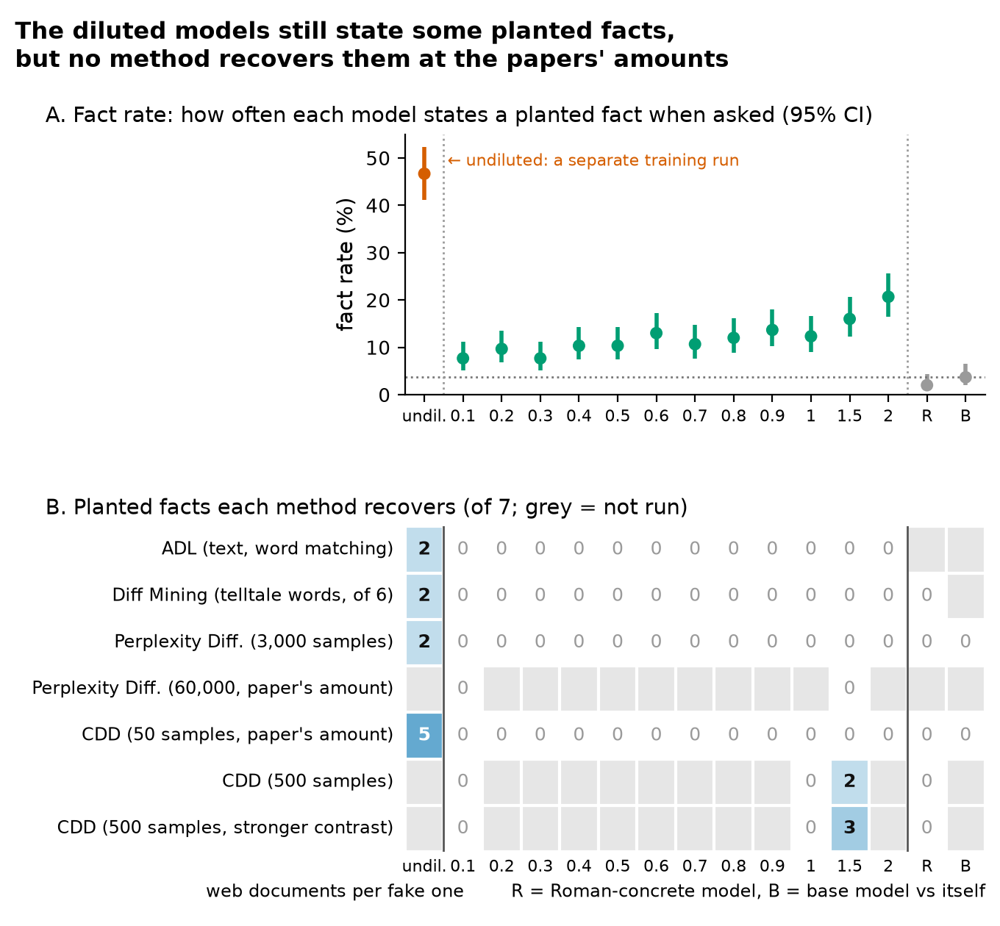

# Diffing under dilution

Do model-diffing methods still find the specific facts a fine-tune planted when the fine-tuning data is
diluted with ordinary web text? This repo has the notebooks, raw outputs and scripts behind every number
and figure in the LessWrong post *Model diffing methods miss facts that diluted fine-tunes still know*
(link to be added).

**Setup:**
- Base model: Qwen3-1.7B.
- Fine-tunes: public cake_bake LoRA adapters, trained on 40k synthetic documents that plant 7 false baking
  facts.
- Dilution series: 12 public diluted versions from the ADL paper (1:0.1 … 1:2 fine-tune:C4).
- Controls: a Roman-concrete adapter and the base model compared with itself.
- Methods: ADL, Diff Mining, Perplexity Differencing and CDD.



## Main results

From `writeup/RESULTS_TABLES.md`; each item notes the table it comes from.

- **Belief (table 2).** The diluted models still state a planted fact in 7.7–20.7% of answers to open baking
  questions. The undiluted model does so in 46.7% and the base model in 3.7%.
- **Undiluted, facts recovered (tables 5, 7c, 8).** CDD recovers 5 of 7 facts. Perplexity Differencing
  recovers 2. ADL's steered text mentions 2 (keyword check only). Diff Mining's tokens hint at 2 of the 6
  facts a single token can express.
- **Diluted, at standard budgets.** None of the four methods recovers any fact at any of the 12 levels.
  - With more budget (table 5): full-budget Perplexity Differencing still finds 0. CDD with 10× samples
    finds 2–3 facts, at 1:1.5 only.
  - Diff Mining keeps the topic (table 8): "cake" stays in its top 25 tokens at every level.
- **Controls (tables 4, 5).** Under the both-detectors rule, every run on the Roman-concrete model and on
  base vs base gives 0 facts.
- **Confound (tables 1, 2c).** These released models don't isolate dilution. Within the mix series, the ratio and
  the number of optimizer steps rise together (58 → 194), and the fact rate rises with them (7.7% → 20.7%).
  The undiluted adapter is a separate run: 222 steps with about 4× less compute per step.

## What's here

| Folder | Experiment | Kaggle notebook | Tables |
|---|---|---|---|
| `stage0/` | Belief check: do the models state the facts? | [diffing-dilution-stage0-belief](https://www.kaggle.com/code/umangagarwal03/diffing-dilution-stage0-belief) | 2, 2b |
| `adl_dilution/` | ADL difference norms and baking z-scores across models | [diffing-dilution-adl-across-models](https://www.kaggle.com/code/umangagarwal03/diffing-dilution-adl-across-models) | 6b, 6c |
| `adl_repro_fig8/` | ADL Fig. 8 reimplementation, all 13 cake models | [adl-repro-fig8-dilution](https://www.kaggle.com/code/umangagarwal03/adl-repro-fig8-dilution) | 6, 7c |
| `adl_official/` | ADL with the authors' toolkit (undiluted, 1:1) | [adl-official-toolkit-smoke](https://www.kaggle.com/code/umangagarwal03/adl-official-toolkit-smoke) | 7, 7b, 7c |
| `ppl_cdd/` | CDD and Perplexity Differencing, all models, standard budget | [ppl-cdd-dilution-cake](https://www.kaggle.com/code/demoiverrakada/ppl-cdd-dilution-cake) | 2, 3 |
| `ppl_cdd_budget/` | Larger budgets, plus the second (LLM-judge) detector over all texts | [ppl-cdd-budget-and-judge](https://www.kaggle.com/code/demoiverrakada/ppl-cdd-budget-and-judge) | 4, 4b, 5 |
| `diff_mining/` | Diff Mining with the authors' toolkit, 13 cake models + Roman concrete | [diff-mining-dilution-cake](https://www.kaggle.com/code/umangagarwal03/diff-mining-dilution-cake) | 8 |
| `writeup/` | `recompute.py` (all tables), `make_figures.py` (all figures), `RESULTS.md` (index and settings), `models_and_revisions.json` (exact Hugging Face revisions and training amounts) | — | all |
| `PLAN.md` | Plan and dated lab log, including the fact-scoring rules fixed before each run | — | — |

Each experiment folder has the notebook, its `kernel-metadata.json` and an `output/` folder with the raw
files Kaggle produced. All runs used Kaggle's free 2× T4 GPUs.

## Reproduce

Check that the files match the hashes:

```bash
shasum -a 256 -c writeup/MANIFEST.sha256
```

Recompute every table and figure from the raw outputs (no GPU needed):

```bash
pip install -r requirements.txt
python writeup/recompute.py      # writes writeup/RESULTS_TABLES.md
python writeup/make_figures.py   # writes the two figures in writeup/
```

To rerun an experiment, push its folder to Kaggle with a GPU, then download the outputs:

```bash
kaggle kernels push -p <folder> --accelerator NvidiaTeslaT4
kaggle kernels output <user>/<slug> -p <folder>/output
```

Change the `id` in `kernel-metadata.json` to your own Kaggle username first.

## Notes on the authors'-toolkit runs

ADL and Diff Mining use
[science-of-finetuning/diffing-toolkit](https://github.com/science-of-finetuning/diffing-toolkit) at
commit `c3f3d10`, with these changes to fit Kaggle's free GPUs:

- **vLLM stubbed.** Neither method uses it, but the toolkit imports it.
- **Local graders.** The toolkit's GPT graders were replaced by Qwen3-4B-Instruct-2507, served through a
  small OpenAI-compatible endpoint. The toolkit's own grader prompts and code are unchanged.
- **Other settings:** fp16, wandb off, no agent evaluation.
- **One memory-only patch for Diff Mining.** Logits are written into a preallocated tensor instead of a
  list followed by `torch.cat`. The values are identical.
- **Incomplete 1:1 ADL run.** Its grader ran out of GPU memory after logit-lens positions 0–1. Steering
  finished for all positions.

CDD and Perplexity Differencing have no public code, so they were implemented from the papers. Settings
are in `writeup/RESULTS.md`.

## Built on

- Minder et al. (2026), [Narrow Finetuning Leaves Clearly Readable Traces in Activation Differences](https://arxiv.org/abs/2510.13900), ICLR 2026 (ADL and the dilution series).
- Kocher et al. (2026), [Diff Mining: Logit Differences Reveal Finetuning Objectives](https://arxiv.org/abs/2608.26462).
- Abu Baker, Baroni & Wilhelm (2026), [Most Current Model Organisms Are Leaky: Perplexity Differencing Often Reveals Finetuning Objectives](https://arxiv.org/abs/2605.00994).
- Brzozowski et al. (2026), [Reading the Finetuning Prior: Verbatim Content Recovery via Contrastive Decoding Diffing](https://arxiv.org/abs/2605.25902).
- Szablewski et al. (2026), [The Model Organism Lottery](https://arxiv.org/abs/2607.01033).
- Wang et al. (2025), [Modifying LLM Beliefs with Synthetic Document Finetuning](https://alignment.anthropic.com/2025/modifying-beliefs-via-sdf/) (the cake_bake facts).
- Adapters by Stewart Slocum: [huggingface.co/stewy33](https://huggingface.co/stewy33).

## AI use

Umang Agarwal chose the question and directed the work. Claude (Anthropic's Claude Code) wrote and ran the
code.

## License

MIT (see `LICENSE`). The models, datasets and the diffing toolkit keep their own licenses.
